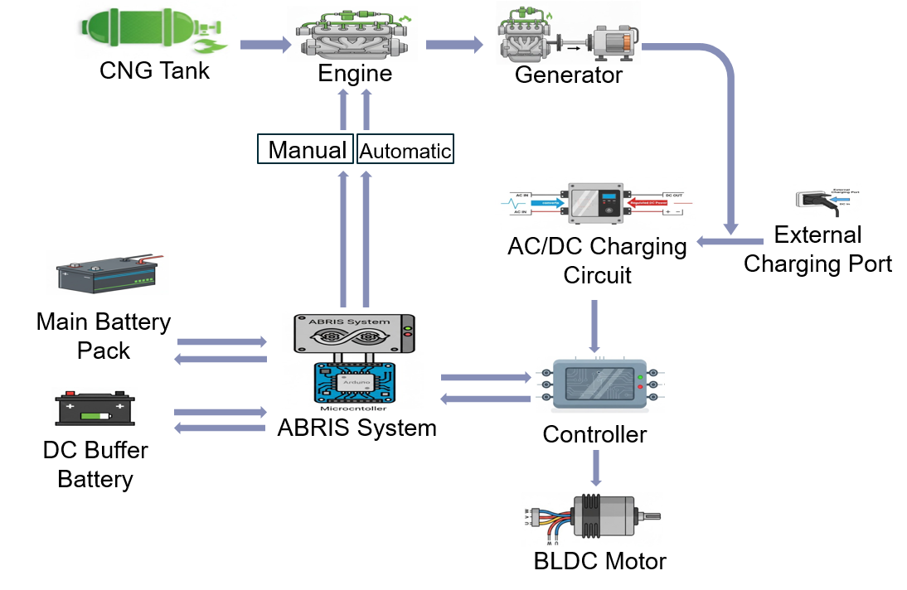
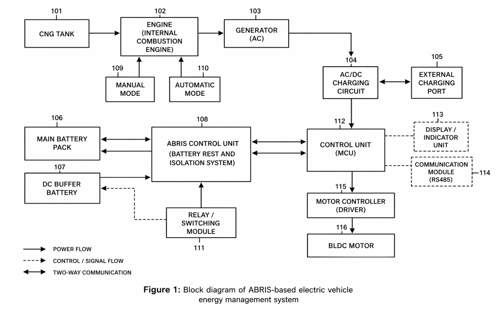
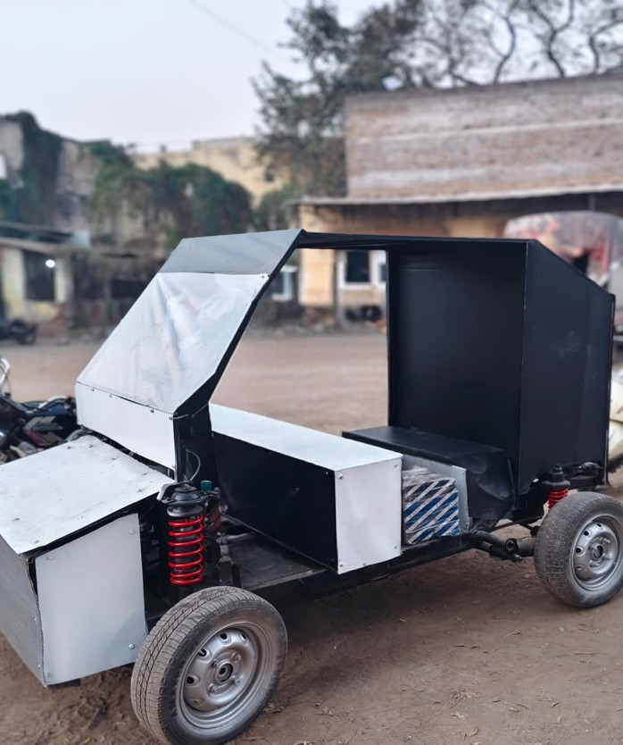
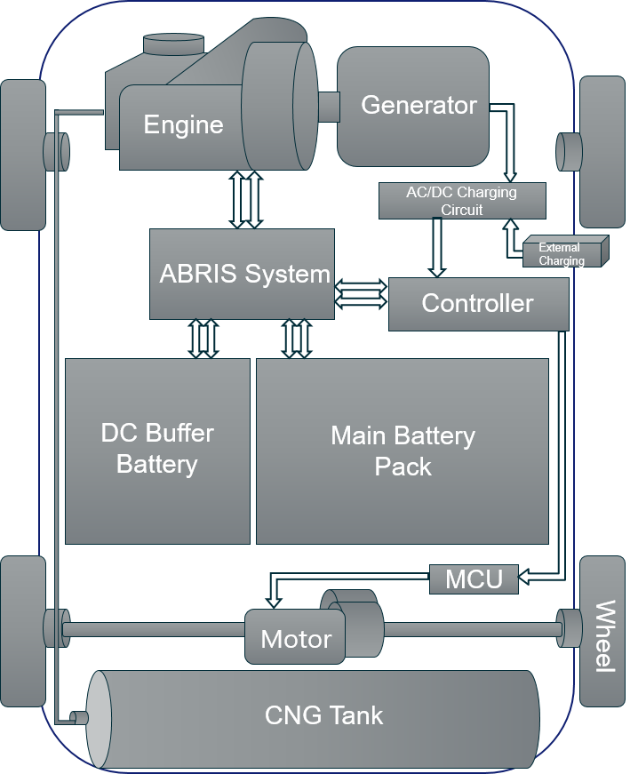

# ABRIS™ – Automatic Battery Rest & Isolation System

> An intelligent battery management system designed to improve battery life, reduce thermal stress, and enhance the driving range of Electric Vehicles (EVs) using a CNG-powered Range Extended Electric Vehicle (REEV) architecture.

---

## 📌 Project Overview

ABRIS (Automatic Battery Rest & Isolation System) is an innovative battery protection system developed for Electric Vehicles. It automatically isolates the main battery during high-load or high-temperature conditions and temporarily powers the vehicle using a DC buffer battery supplied by a CNG-powered generator.

This approach reduces battery stress, minimizes overheating, improves battery lifespan, and enables continuous driving without compromising vehicle performance.

---

## 🚀 Problem Statement

Current Electric Vehicles face several challenges:

- Limited driving range
- Battery overheating during continuous operation
- Faster battery degradation
- High dependence on expensive cooling systems
- Petrol-based range extenders increase operating costs

ABRIS addresses these challenges by introducing an intelligent battery rest mechanism.

---

## ✨ Key Features

- Automatic Battery Rest & Isolation System (ABRIS)
- Intelligent battery switching during heavy load
- DC Buffer Battery Integration
- CNG-based Range Extender
- Real-time Battery Monitoring
- Temperature-based Protection
- Low-cost Plug-and-Play Design
- Compatible with EVs and REEVs

---

## ⚙ Technologies Used

### Hardware

- Arduino Microcontroller
- Battery Management System (BMS)
- RS-485 Communication Module
- PZEM-017 DC Power Monitor
- DS18B20 Temperature Sensor
- Relay Module
- DC Buffer Battery
- Main Battery Pack
- BLDC Motor
- CNG Engine & Generator

### Software

- Arduino IDE
- Embedded C/C++
- Battery Monitoring Logic

---

## 🏗 System Architecture

The system consists of:

- Main Battery Pack
- DC Buffer Battery
- ABRIS Controller
- Temperature Sensor
- Battery Management System
- CNG Engine
- Generator
- Motor Controller
- BLDC Motor

---

## 📷 Project Gallery

### System Architecture



### Circuit Diagram



### Hardware Prototype



### Energy Flow



---

## 🎥 Project Demonstration

Demo Video:

`videos/Demo.mp4`

---

## 📊 Expected Benefits

- Extended battery lifespan
- Reduced battery stress
- Lower operating cost
- Improved thermal safety
- Better driving efficiency
- Continuous driving capability
- Suitable for hot climate conditions

---

## 📁 Repository Structure

```
ABRIS-EV-System
│
├── assets/
├── code/
├── docs/
├── presentation/
├── videos/
├── README.md
└── LICENSE
```

---

## 👨‍💻 Team

- **Sahil Somase** – Team Leader & System Integration
- **Aditya Bhosale** – Hardware & Circuit Design
- **Vishal Jagtap** – Software & Arduino Programming
- **Siddharth Jagtap** – Testing & Performance Validation
- **Roshan Bhakad** – Research & Documentation

---

## 📄 License

This project is shared for educational and research purposes.

© 2026 EcoDrive Innovators.